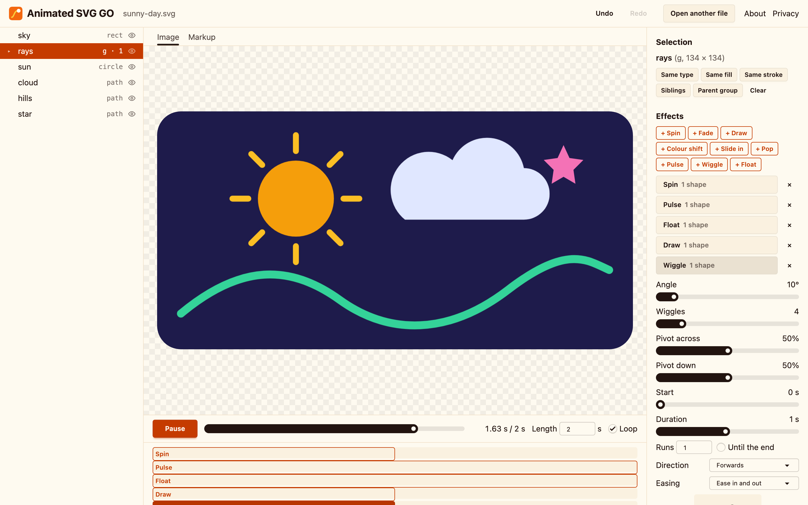
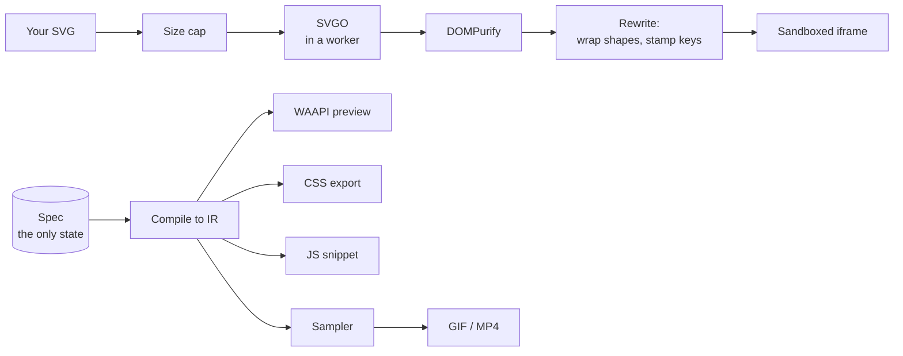

<p align="center">
  <a href="https://www.svgomg.fyi"></a>
</p>

<h1 align="center">Animated SVG GO</h1>

<p align="center">
  <strong>Drop in an SVG. Make it move. Export it.</strong><br>
  Think <a href="https://jakearchibald.github.io/svgomg/">SVGOMG</a>, but for motion. Free, no account, and nothing leaves your browser.
</p>

<p align="center">
  <a href="https://www.svgomg.fyi"><strong>Open the editor →</strong></a>
  &nbsp;·&nbsp;
  <a href="https://marketplace.visualstudio.com/items?itemName=ddools.animated-svg-go">VS Code extension</a>
  &nbsp;·&nbsp;
  <a href="https://www.svgomg.fyi/about">About</a>
  &nbsp;·&nbsp;
  <a href="https://www.svgomg.fyi/privacy">Privacy</a>
</p>

<p align="center">
  <a href="https://github.com/ddools/animated-svg-go/actions/workflows/ci.yml"></a>
  <a href="https://marketplace.visualstudio.com/items?itemName=ddools.animated-svg-go"></a>
  <a href="LICENSE"></a>
</p>

<p align="center">
  
  <br>
  <sub>This image is a real export. Five shapes, five effects, about a minute in the editor. 4 KB of plain SVG and CSS.</sub>
</p>

---

## What it does

Pick the shapes you want. Add a spin, a fade, a line that draws itself. Tune it with sliders, then take it anywhere. No code, no account, no upload.



- **Select** any shape or group from the layer list, or click and lasso on the drawing. Grow the selection by type, fill, stroke or siblings.
- **Animate** with nine effects. Stack them, stagger them, pick an easing, drag the pivot.
- **Scrub** a looping timeline and see exactly what you'll export.
- **Undo and redo** everything. Your last file and its effects are saved in this browser.

### Nine effects

| Effect | What it does |
| --- | --- |
| Spin | Turns round a pivot you can drag |
| Fade | Opacity from one value to another |
| Draw | Strokes a line on, like a pen |
| Pop | Grows in from a smaller size |
| Float | Drifts up and down, or across |
| Wiggle | A quick back-and-forth tilt |
| Pulse | Swells and settles, with an optional fade |
| Slide in | Arrives from off to one side |
| Colour shift | Moves the fill or stroke to a new colour |

Every effect has a start, duration, run count, direction and easing. Easings include `cubic-bezier()`, `steps()` and springs.

### Five ways out

| Export | Good for |
| --- | --- |
| Animated SVG | One file with its CSS inside. Use it in an ``, a README, anywhere. |
| SVG + CSS | Inline markup and a `<style>` block to paste into a page. |
| SVG + JS | Inline markup and a few lines of the Web Animations API, for when you want control. |
| GIF | Chat, email, slides. Timelines up to 20 s. |
| MP4 | Video editors and social posts. Timelines up to 20 s. |

The SVG, CSS and JS exports stop moving for anyone who has asked their system for less motion (`prefers-reduced-motion`). None of them need a runtime library.

## In VS Code

The same editor runs inside VS Code. Install [Animated SVG GO from the Marketplace](https://marketplace.visualstudio.com/items?itemName=ddools.animated-svg-go), or run:

```sh
code --install-extension ddools.animated-svg-go
```

Right-click any `.svg` and choose **Open with Animated SVG GO**. Exports are saved where you choose, your SVG is never changed, and your effects come back when you reopen the file. Tested in VS Code on Mac.

## Your files stay with you

Everything runs in your browser. There is no server, no upload and no account. The live site is static files. Page views are counted with Vercel Web Analytics; the [privacy page](https://www.svgomg.fyi/privacy) says what it records. Your files are never part of it.

Uploaded SVG is treated as hostile:

1. **Capped.** Files over 5 MB, 20,000 elements or 64 levels deep are refused before any work starts.
2. **Tidied** by SVGO in a worker.
3. **Sanitised** by DOMPurify with a strict SVG profile. Scripts, event handlers, foreign content and uploaded SMIL are removed.
4. **Sandboxed.** The drawing is shown in an `<iframe sandbox>` that can't run scripts, with its own deny-all Content Security Policy. It never enters the app's own page.

The test suite detonates a set of known SVG XSS payloads against the pipeline in Chromium, Firefox and WebKit on every pull request. Found a way past it? Please [open a private security advisory](https://github.com/ddools/animated-svg-go/security/advisories/new) rather than a public issue.

## How it works



- **The spec is the only state.** Effects, timings and selections live in one validated object. Undo and redo work on it. The preview, the DOM and every export are derived from it.
- **One IR, many backends.** The spec compiles to an intermediate form of keyframe tracks. The live preview (Web Animations), the CSS and JS exports, and the raster sampler for GIF and MP4 all read that one IR.
- **Preview equals export.** If an effect can't be written as CSS keyframes, it isn't an effect. `pnpm parity` renders the preview, the exported SVG in an `` and the sampler's frames, then checks the pixels match.
- **Authored markup is never edited.** Each animated shape is wrapped in a group. Motion moves the wrapper; colour paints the shape. Pivots are baked into the keyframes, so there's no `transform-origin` guesswork across browsers.

The full design, including the platform traps it works around, is in [docs/ARCHITECTURE.md](docs/ARCHITECTURE.md).

## Browser support

Chrome, Firefox and Safari on desktop, plus [VS Code](#in-vs-code). Phones and tablets aren't supported yet.

## Run it locally

You need Node 22.12 or later and [pnpm](https://pnpm.io).

```sh
git clone https://github.com/ddools/animated-svg-go.git
cd animated-svg-go
pnpm install
pnpm dev
```

| Command | What it runs |
| --- | --- |
| `pnpm dev` | Astro dev server |
| `pnpm build` | Production build into `dist/` |
| `pnpm test` | Vitest unit tests |
| `pnpm test:e2e` | Playwright end-to-end and security tests in Chromium, Firefox and WebKit, against a production build |
| `pnpm corpus` | Runs real-world SVGs through the pipeline and pixel-diffs before against after |
| `pnpm parity` | Checks preview, CSS export and sampler frames agree |
| `pnpm lint` | ESLint, svelte-check and `tsc` |
| `pnpm ext:package` | Builds the VS Code extension into `extension/animated-svg-go-<version>.vsix` |
| `pnpm ext:smoke` | Runs the extension's checks in your local VS Code (Mac) |

Run `pnpm exec playwright install` once before the browser suites.

## Project layout

```
src/
  pages/        Landing, editor, about and privacy pages (Astro)
  editor/       The editor: one Svelte 5 island
  core/         Framework-free TypeScript, unit tested
    parse/      Cap, optimise, sanitise, rewrite, inventory
    spec/       The spec schema and one file per effect
    ir/         Compile, evaluate
    backends/   WAAPI, CSS, JS snippet, sampler
    export/     Frame loop, GIF, MP4
  workers/      The SVGO pass
extension/      The VS Code extension: the same editor in a webview
tests/          unit, e2e, corpus, security, parity
docs/           Architecture, roadmap, plan
```

## Roadmap

Path morphing is next, in v1.1. Shareable links come later. See [docs/ROADMAP.md](docs/ROADMAP.md).

## Built on

[SVGO](https://github.com/svg/svgo) tidies every file. [DOMPurify](https://github.com/cure53/DOMPurify) strips anything unsafe. [Mediabunny](https://mediabunny.dev) writes MP4 and [gifenc](https://github.com/mattdesl/gifenc) writes GIF. [Zod](https://zod.dev) checks every saved animation and [idb-keyval](https://github.com/jakearchibald/idb-keyval) keeps your last file. The site is [Astro](https://astro.build), [Svelte](https://svelte.dev), [Tailwind CSS](https://tailwindcss.com) and [daisyUI](https://daisyui.com), hosted on [Vercel](https://vercel.com).

Inspired by Jake Archibald's [SVGOMG](https://github.com/jakearchibald/svgomg). Test fixtures are third-party SVGs used under their own licences, listed in [tests/corpus/LICENCES.md](tests/corpus/LICENCES.md).

Made by [Der Dooley](https://github.com/ddools).

## Licence

[MIT](LICENSE). Third-party test fixtures keep their own licences.
